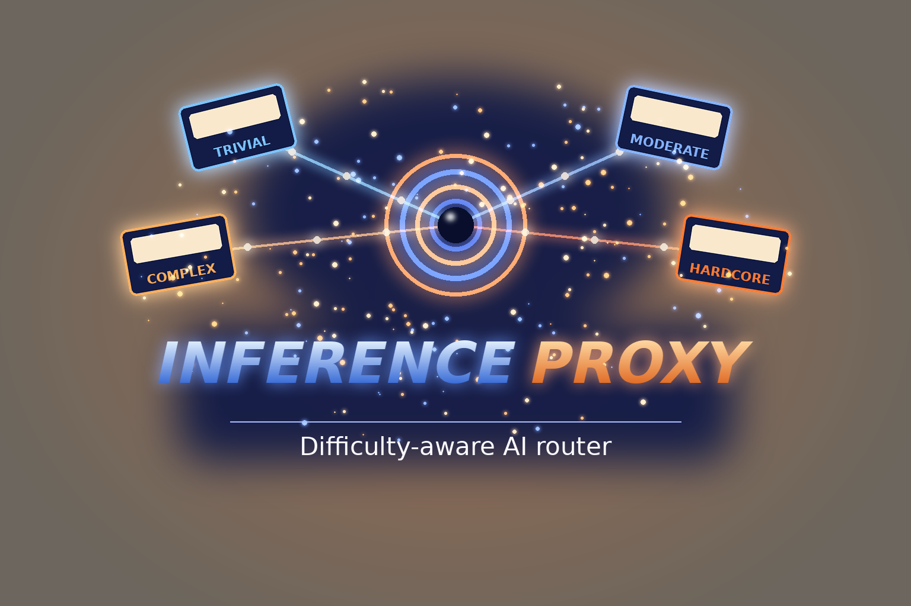

inference-proxy



inference-proxy sits between your AI tools and your AI accounts: it asks a small local model how hard each request is, then sends the easy ones to the local model (free) and the harder ones to hosted providers, rotating between several accounts when one runs out of quota. Any tool that can talk to an OpenAI-compatible endpoint (editors, agents, chat front ends) just points at one address and carries on as normal.

Highlights
- One address for everything: `http://127.0.0.1:8480/v1`, OpenAI-compatible, streaming passed straight through.
- Four tiers: trivial, moderate, complex and hardcore, each with its own list of providers (local first for trivial, bigger hosted models as the score goes up).
- Account pools: any number of API keys per provider, least-busy first, with a cooldown when a key hits its quota or fails to authenticate.
- Fallback: when a tier is used up the proxy tries the tiers either side of it, so a request is only refused when nothing capable is left.
- Media aware: requests with images, video, audio or files (or asking for reasoning) only go to providers that say they can handle them.
- Spending guardrails: per-tier token limits and request defaults, so a reasoning model can't quietly burn a month of budget on one prompt.
- Claude and Codex as providers: the command-line apps can answer requests, so a subscription can sit in a tier next to your API keys.
- Local models stay loaded: pin an endpoint to one model and the proxy never makes a consumer-grade machine swap models mid-request.
- A model ladder: independent scores (Epoch AI, optionally Artificial Analysis) and your price table suggest up to 10 rungs from the cheapest capable model to the strongest, and the four tiers to fill from them.
- Models, not just providers: a different model per tier, automatic stand-ins when a model is retired, and a price table you refresh and approve.
- Admin page: edit thresholds, tiers, providers and keys in the browser, watch account health, run a test request. Changes apply without a restart.

Quick Start
1) Install Python 3.12 or newer and [uv](https://docs.astral.sh/uv/).
2) Get the code: `git clone https://github.com/1larity/inference-proxy.git` then `cd inference-proxy`.
3) Install: `uv sync`.
4) Copy the example settings: `cp config.example.yaml config.yaml`.
5) Fill in keys, either directly in `config.yaml` or by exporting the environment variables it names (`ZAI_KEY_1`, `OPENROUTER_KEY_1` and so on). Anything written as `${NAME}` is read from the environment.
6) Make sure your local model is running (LM Studio or llama.cpp) and that `classifier.base_url` and `classifier.model` match it.
7) Start it: `uv run inference-proxy`.
8) Point your tool at `http://127.0.0.1:8480/v1` and set the model to `auto`.

Check it is up at `http://127.0.0.1:8480/healthz`, and open `http://127.0.0.1:8480/admin` to see it working.

User Guide (no coding needed once it is running)

What it does for you: you stop choosing models. Short chatty questions get answered by the model on your own computer, which costs nothing, and the heavy jobs go to the stronger (paid) accounts. If one of your accounts runs out for the day, the next one takes over and you don't see an error.

Setting up your accounts
- Open `http://127.0.0.1:8480/admin` in your browser.
- Under Providers & accounts, press + Add provider for each service you use (a name, the web address it gave you, and a model name).
- Press + Add account inside a provider and paste your key in (a note like "main account" helps later). Saved keys show as `xxx••••abcd`, and leaving a key box alone keeps the one you saved.
- Under Tier assignments, choose which providers handle each tier. Order matters: the first one is tried first.
- Press Save settings. It takes effect straight away.

Using it from your tools
- Set the tool's API address (sometimes called base URL) to `http://127.0.0.1:8480/v1`.
- Type anything into the API key box if the tool insists on one (unless you set a proxy key under Access, then use that).
- Set the model to `auto` and let it choose. To force a level use `trivial`, `moderate`, `complex` or `hardcore`. To use one provider every time, type its name, for example `zai`, or a provider and model together, for example `zai:glm-4.7`.

Reading the admin page
- Recent requests shows each request with its difficulty score, the tier it landed in, the provider and account used and the model that answered.
- Each account shows as healthy or cooling down (with the seconds left). A cooling account has hit its quota or failed to sign in, and comes back by itself. Press Reset if you have topped it up and don't want to wait.
- Test request lets you type a prompt and see where it would go before you rely on it.
- Routing holds the score thresholds (see the tiers below). Most people never need to touch them.

The four tiers, in plain terms
- Trivial (score 1 to 2): greetings, quick facts, simple rewrites. Handled by your local model.
- Moderate (3 to 5): everyday coding, writing and analysis.
- Complex (6 to 8): harder debugging, design questions, longer multi-part jobs.
- Hardcore (9 to 10): the biggest jobs, sent to your strongest provider.

Using Claude or Codex instead of an API key
- Install the app (`claude` or `codex`) and sign in to it once in a terminal.
- In `config.yaml` add a provider with `type: claude` (or `codex`), list it in the tiers you want, and set `default_model` (`sonnet`, `opus` and `haiku` for Claude). No key is needed.
- These answer in one piece (no word-by-word streaming) and can't return tool calls. A request that defines tools (a coding agent, say) is never sent to one: the proxy skips it and uses your API providers, or answers with a clear error if there are none. Naming the provider yourself (`claude_cli` as the model) still sends it there.
- Each Claude call carries the app's own instructions (roughly 40,000 tokens, mostly served from its cache), so these providers suit harder jobs better than quick questions. The whole conversation is also sent again on every turn, and that part isn't cached: a 20,000 character history makes a call about 1.7 times dearer than an empty one, and 80,000 characters about 4 times (measured with Claude Haiku). Keep them out of the trivial tier and away from very long sessions.
- Every request starts a fresh CLI session and sends the whole conversation again, then removes the session record it leaves behind (Codex runs with `--ephemeral`), so the CLI never holds its own copy of the conversation and your editor's history stays the only one.

Keeping your local model loaded
- Servers such as LM Studio load whichever model a request names, and swapping on a home PC can take half a minute. Add `pin_model: true` to the local provider (it then only ever uses its `default_model`), or list the endpoint under `pinned_models` in `config.yaml`.
- A pinned endpoint also pins the difficulty judge if the judge lives there, so judging and answering use the same loaded model.
- If the pinned model is missing the proxy moves on to the next provider and does not ask the local server for another model.

Choosing models: the ladder
- In the admin page open Models and prices, press Refresh scores, then look at the ladder. It lists up to 10 rungs, each covering a band of difficulty scores, from the weakest cheap model to the strongest, and says which model it would put in each of your four tiers.
- Scores come from Epoch AI's Capabilities Index (free, no sign-up) and, if you add your own free Artificial Analysis key, their intelligence index and speed. They help order models, they don't prove quality.
- Tolerance is how much quality you will give up for a cheaper or faster model (3% by default). A fast model that scores 2% lower than the flagship wins at the default, as long as it is cheaper in the price table. On a flat-rate plan, type relative weights into the price table by hand (say 1 for the flash model and 3 for the full one), because the plan has no per-token price.
- Nothing is changed for you: the ladder is a suggestion to copy into your tiers.

Letting it do the homework (optional, off by default)
- With `research.enabled: true` the proxy refreshes prices and scores every few days. If you give it a Claude CLI provider and the pricing page for a provider, it asks Claude to read the page and lists what it found as price proposals.
- Everything it finds waits for you in the admin page. The pages it reads are treated as data, never as instructions, and a proposal is only accepted for a model the provider really lists, at a plausible price, with an https source.

Keeping prices up to date
- In the admin page open Prices and press Refresh. The proxy asks each provider what it offers and files any new, changed or retired prices as proposals. Nothing changes until you press Apply (or Reject).
- Prices you type in yourself are kept as they are. Anything older than two weeks is marked stale.
- Usage shows what your requests really cost, using the price that applied at the time.

If something looks wrong
- Every answer comes back with headers (`X-Proxy-Tier`, `X-Proxy-Provider`, `X-Proxy-Account`) saying who answered, so you can always see where a request went.
- If everything lands in the same tier, check the local model is running: when the judge can't be reached the proxy guesses from the length and wording of the prompt instead, which is cruder.
- A 400 saying no provider can take the request means it contained an image, audio or similar and none of your providers for that tier list that ability. Add the capability to a provider that supports it.

How It Works (technical write-up)

Routing
- The conversation transcript (truncated to `classifier.max_chars`) goes to the local judge with a short system prompt asking for a single integer from 1 to 10. The default thresholds map that onto the tiers: trivial up to 2, moderate from 3, complex from 6, hardcore from 9 (`routing.trivial_max`, `moderate_min`, `complex_min`, `hardcore_min`).
- If the judge is down or answers with something that isn't a number, a heuristic scores the prompt instead: longer text scores higher, a list of hard words (prove, architecture, race condition, compiler and similar) pushes it up, and short greetings pull it down.
- Prompts above `classifier.oversize_ratio` of the judge's context window skip the judge altogether (an overflowing judge is unreliable) and use the heuristic, floored at `routing.moderate_min`. The context size is probed from LM Studio at startup and corrected from any overflow error seen later, or you can set `classifier.context_chars` by hand.
- A `model` value other than `auto` bypasses judging: a tier name forces that tier, a provider name pins that provider's default model, `provider:model` pins both.

Account pools
- Each provider holds a list of accounts. Selection prefers the healthy account that is least busy, then least recently used.
- 429 and 402 responses (and error bodies that sound like quota) park the account for `quota_cooldown_seconds` (600 by default). Auth failures park it for `auth_failure_cooldown_seconds` (3600). Server and network errors back off exponentially from 5 seconds up to a 60 second cap. Other 4xx errors are relayed as they are, with no retry.
- When every account in a tier is cooling down the proxy walks to the tiers below first, then the ones above, if `routing.fallback_to_other_tiers` is on.
- Cooldowns are written to `server.state_file` so a restart doesn't forget which accounts are parked.

Capabilities
- Each provider lists what it accepts: `text` (required), `image`, `video`, `audio`, `file`, `reasoning`.
- Requests containing `image_url`, `video_url`, `input_audio` or `file` parts, or asking for reasoning (`reasoning_effort`, `reasoning`, `enable_thinking`, `thinking`), are only routed to providers declaring the matching capability. The tier is chosen as usual and incapable providers are skipped, sliding across tiers when needed. If nothing qualifies the proxy returns a 400 rather than forwarding a request that can't work.
- Pinning a provider bypasses the filter and an upstream rejection is relayed. If a provider rejects media as unsupported anyway (a default model without vision, say), the proxy fails over to the next capable provider unless it was the last one.

Models and fallbacks
- A provider's `tier_models` choose its model per tier (a cheap one for trivial, a strong one for hardcore), with `default_model` as the fallback. A `model` pinned in the request always wins.
- If the chosen model comes back as missing or retired (a 404, or a 400 that says so), the proxy tries the provider's `fallback_models`, or failing that the chat models in its `/models` list (loaded ones first, embeddings and audio models skipped, three at most) before moving to the next provider. This never happens for pinned models or for requests with images or audio.
- `GET /admin/api/models` shows what each provider offers and `POST /admin/api/models/refresh` fetches it again.
- With no local model, leave the tiers out (a missing tier takes the providers of the nearest tier you did list) and set `classifier.provider: auto`: difficulty is judged by the local server when it answers and otherwise by the first hosted provider, using its trivial-tier model.
- A provider that goes offline (a local machine whose GPU is busy with something else, say) is parked with a short backoff, retried every minute or so, and the next provider covers meanwhile.

Prices and usage
- Prices are per million tokens in US dollars. A refresh reads `pricing` from each provider's `/models` (the OpenRouter shape) and writes proposals: new, changed or retired. Applying a proposal replaces the active price, and each request is costed at the price active when it ran.
- The ledger records the tokens each upstream reports (for streams, when the final chunk carries usage) and the cost. `GET /admin/api/usage?days=7` totals it by provider, model and tier.
- `server.data_db` is the SQLite file that holds both (in memory if unset).

Endpoint pinning
- `pinned_models` maps an endpoint's base URL (compared without a trailing slash, ignoring case) to its one model. A provider with `pin_model: true` pins its `default_model`. Two providers pinning one endpoint to different models is a startup error.
- On a pinned endpoint the proxy ignores `tier_models` and `fallback_models`, skips the sibling-model search and uses the pinned model for the difficulty judge. A request pinned by the client as `provider:model` is the one thing that can still change the model.
- CLI providers have no endpoint, so a pin has no effect on them.

Scores and the ladder
- Scores are stored with their source in the same SQLite file as prices. Model ids are matched after normalising case and punctuation (`GLM-5.3-Flash` and `z-ai/glm-5.3-flash` are the same key, and a trailing `-gguf` is ignored), so an unlisted model simply has no score and shows under "unscored".
- `POST /admin/api/scores/refresh` downloads Epoch's data (CC BY 4.0, credit shown) and, with `benchmarks.aa_api_key`, Artificial Analysis (free tier, 100 requests per 24 hours, credit shown).
- `GET /admin/api/ladder?rungs=10&tolerance=0.03&source=epoch` builds the ladder from the models each provider lists. Candidates are one per endpoint and model, and a pinned endpoint offers only its pinned model. For each rung it takes the model at that quantile of the score range, then swaps in any model within the tolerance that costs less, then is faster, then scores higher. The four tiers take the rungs nearest their difficulty bands (1-2, 3-5, 6-8, 9-10), and `suggested_tier_models` is a block ready to paste into the config.
- The ladder is advice for the four named tiers. Routing still uses four tiers.

Research job
- `research.enabled` starts a background loop that runs every `every_days` (the last run is kept in the database, so a restart doesn't repeat it). Each pass refreshes provider prices, refreshes scores and, for each entry in `research.price_pages`, asks the `research.cli_provider` (type `claude`, the only CLI with web tools here) to read the page with WebSearch and WebFetch only.
- Only strict JSON is accepted. Models must already be in the provider's catalogue, prices must be numbers from 0 to 1000 and the source must be an https URL. The result becomes a proposal and is never applied automatically. `POST /admin/api/research/prices` runs one provider on demand.

Spending guardrails
- The precedence is explicit client value, then tier policy, then provider default.
- `tier_policies` set a default `max_tokens` (only injected when the client sent none) and `extra_body` fields (deep-merged only where the client stayed silent, so a client asking for a specific reasoning level always gets it).
- A provider's `extra_body` works the same way one level down, and `max_tokens_cap` is an opt-in hard clamp applied last.

```yaml
tier_policies:
  trivial:
    max_tokens: 2048
    extra_body: {"thinking": {"type": "disabled"}}
  moderate:
    max_tokens: 8192
  hardcore: {}      # client decides
```

Settings and the admin overlay
- `config.yaml` is the base. Admin page edits are saved to `ui-settings.json` (set `server.settings_file` to `null` to turn this off) and deep-merged over the YAML at startup. The YAML file is never rewritten.
- The overlay holds keys in plain text, so it is in `.gitignore`. Keys come back from the API masked, and sending a masked value back means keep the current key.
- Providers are generic labels: any name, any number, any tier. Deleting one in the UI unassigns it and the deletion persists. A tier can't be left empty.
- Set `server.api_key` to require `Authorization: Bearer <key>` on the proxy and admin endpoints.

Response metadata
- Headers: `X-Proxy-Tier`, `X-Proxy-Provider`, `X-Proxy-Account`, `X-Proxy-Difficulty`, `X-Proxy-Difficulty-Method`.
- Non-streaming bodies also carry an `inference_proxy` object with the same values.

Key Endpoints
- `POST /v1/chat/completions` and `GET /v1/models`: the OpenAI-compatible API.
- `GET /healthz`: liveness.
- `/` or `/admin`: the admin page.
- `GET /admin/api/models`, `POST /admin/api/models/refresh`: the model catalogue.
- `GET /admin/api/prices`, `PUT /admin/api/prices` (set one by hand), `POST /admin/api/prices/refresh`, `/apply`, `/reject`: the price table.
- `GET /admin/api/usage?days=7`: cost and tokens by provider, model and tier.
- `GET /admin/api/scores`, `POST /admin/api/scores/refresh`: independent benchmark scores and their credits.
- `GET /admin/api/ladder`: the suggested model ladder (query: `rungs`, `tolerance`, `source`).
- `POST /admin/api/research/prices`: ask a Claude CLI provider to read a pricing page and file proposals.
- `GET /admin/pools`: per-account health, cooldowns and counters.
- `GET /admin/api/settings`: effective settings with keys masked. `PUT` applies and saves them.
- `POST /admin/api/pools/{provider}/accounts/{index}/reset`: clear one account's cooldown.
- `GET /admin/api/recent`: the recent request log behind the admin page.

Repo Structure
- `src/inference_proxy/`: `main.py` (FastAPI app and admin API), `router.py` (tiers), `classifier.py` (difficulty judge and heuristic), `pool.py` (accounts and cooldowns), `upstream.py` (error classification), `media.py` and `context.py` (capability detection and context sizing), `config.py` and `settings.py` (YAML plus the UI overlay), `static/index.html` (admin page).
- `tests/`: pytest with the upstreams mocked.
- `config.example.yaml`: a commented starting point.
- `docs/`: the header image.

Development
- Tests: `uv run pytest`.
- Auto-reload while editing: `uv run uvicorn inference_proxy.main:create_app --factory --reload`.
- Config is read from `./config.yaml`, or from the path in `INFERENCE_PROXY_CONFIG`.

License
- CC BY-NC-SA 4.0: https://creativecommons.org/licenses/by-nc-sa/4.0/
- Attribution, non-commercial use and share-alike required: link this source and the licence and indicate changes. Third-party licences and previous grants are preserved.
